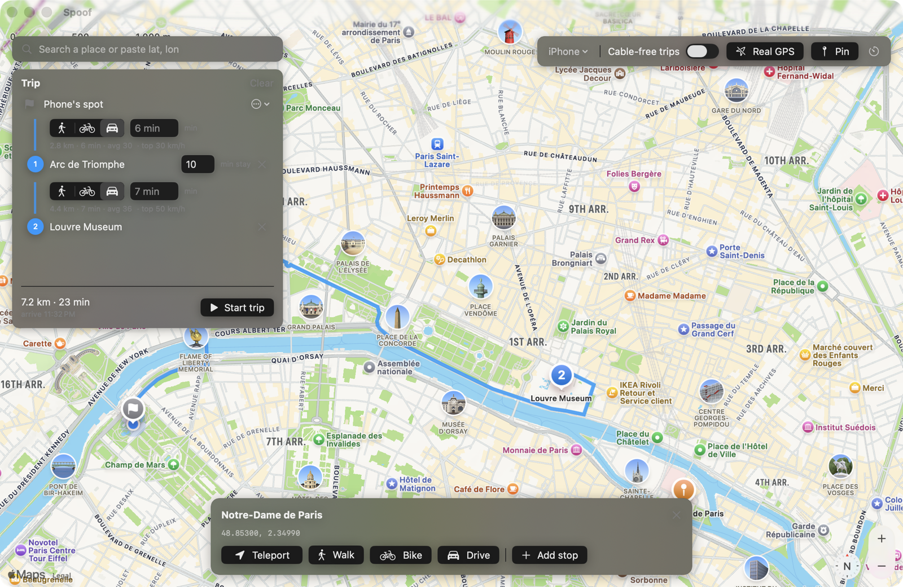

<p align="center">
  
</p>

<h1 align="center">Spoof</h1>

<p align="center">Set your iPhone's location from your Mac.</p>

<p align="center">
  <a href="https://github.com/danielrltan/spoof/releases/latest/download/Spoof.dmg">
    
  </a>
</p>

<p align="center"><sub>Free. Needs an Apple silicon Mac on macOS 26.6 or newer, an iPhone and a cable.</sub></p>

<p align="center">
  
</p>

## Set up once

1. Install [Xcode](https://apps.apple.com/app/id497799835) (free, version 27 or newer) and open it once.
2. Open `Spoof.dmg` and drag Spoof to Applications.
3. Open Spoof. Your Mac will block it because it isn't notarized. Click **Done**, then go to **System Settings > Privacy & Security** and click **Open Anyway**.
4. Plug in your iPhone and tap **Trust**.
5. On the iPhone, go to **Settings > Privacy & Security > Developer Mode**, turn it on and restart. If it isn't there, open Xcode with the iPhone plugged in and choose **Product > Destination > Manage Devices**.

Spoof tells you which step is missing.

## Use it

1. Search for a place or click the map.
2. Click **Teleport** to jump there, or **Walk**, **Bike** or **Drive** to travel there by road.
3. Click **Real GPS** when you're done. Your phone can take a minute to find itself again.

You can unplug after a teleport and the location stays. Keep the phone plugged in during a trip, or turn on **Cable-free trips** first.

To plan a longer trip, click **Start trip here** or **Add stop**, then choose how you travel, how long each leg takes and how long you stay.

## Good to know

- Use it on your own phone, and don't use it to mislead someone who relies on your location.
- Apps can tell. iOS marks every location from Spoof as simulated.
- Driving routes and speed limits come from [OpenStreetMap](https://www.openstreetmap.org/copyright) through the public [Valhalla](https://valhalla.github.io/valhalla/) server, so the start and end of each drive are sent there. Walking and cycling routes come from Apple Maps.

## Build it yourself

```sh
brew install xcodegen
cd mac && xcodegen generate && open Spoof.xcodeproj
```

`cli/spoof.swift` is a command-line version: `swiftc cli/spoof.swift -o spoof`, then `./spoof set "Paris"`.

[MIT License](LICENSE)
